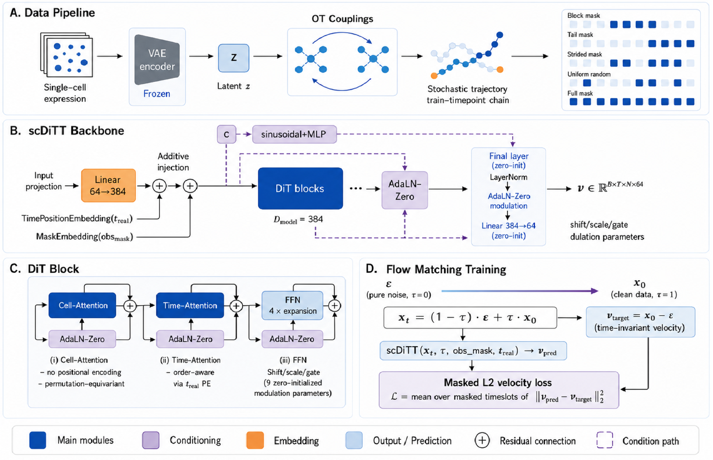

# scDiTT: Diffusion Transformers for Single-Cell Temporal Prediction

scDiTT is a latent-space masked-diffusion model that completes single-cell RNA-seq time
courses. Given population snapshots observed at a subset of biological timepoints, it
predicts the gene-expression distribution of the cell population at held-out timepoints —
both *interpolation* (missing intermediate timepoints) and *extrapolation* (timepoints
beyond the last observation) — in a **single non-autoregressive conditional pass** over all
observed timepoints, rather than by integrating a per-cell ODE/SDE step by step.

  

---

## Abstract

Time-course single-cell RNA sequencing (scRNA-seq) provides snapshots of evolving cell populations, enabling the study of developmental and differentiation processes. Predicting unsampled stages from observed time points is typically formulated as learning local transition dynamics and integrating them forward. However, such autoregressive formulations suffer from error accumulation over long horizons and may not fully capture the population-level uncertainty of future cellular states. In this work, we formulate single-cell temporal prediction as a conditional generation problem over evolving cell populations and introduce scDiTT, a diffusion transformer for temporal prediction of single-cell populations. Inspired by generative models for sequential data, scDiTT treats a cellular time course as a sequence of population states and generates missing stages jointly, conditioning each target stage on all observed states rather than recursively applying local transitions. To accommodate the unique structure of single-cell dynamics, scDiTT employs permutation-equivariant cell attention and temporal attention with continuous-time encoding for irregular sampling intervals. We further introduce optimal-transport-based trajectory construction to assemble unpaired cellular snapshots into trainable temporal sequences, enabling self-supervised learning through masked stage completion. Across five real-world time-course scRNA-seq datasets, scDiTT achieves state-of-the-art performance in both interpolation and extrapolation tasks, while substantially reducing long-horizon error accumulation. Generated populations further preserve biologically meaningful cell-type compositions and temporal patterns of marker-gene programs. Our results demonstrate that diffusion transformers provide a powerful framework for modeling complex temporal dynamics of single-cell populations.